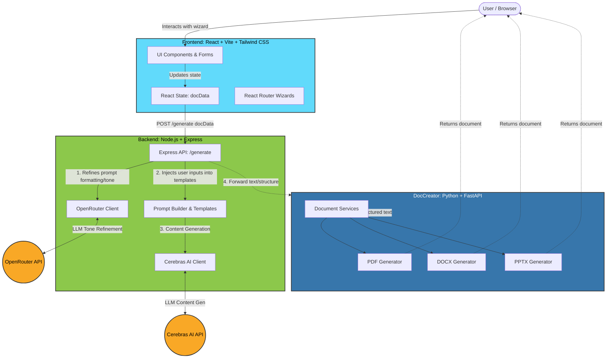

# docForU: System Architecture

The **docForU** project is designed as a multi-tier web application, separating concerns into a distinct frontend, an AI-orchestration backend, and a specialized document generation microservice.

## High-Level Architecture Diagram

---

## 1. Frontend Layer (React + Vite)
- **Role:** Web client providing a user-friendly configuration wizard.
- **Tech Stack:** React, Vite, Tailwind CSS, React Router DOM.
- **Flow:** Users progress through multiple wizard pages (`Home` -> `TopicName` -> `DocTypeSize` -> `StrucOfDoc` -> `RulesForDoc`). The application state (`docData`) aggregates all selections (e.g., topic name, number of slides, sections like Introduction/Conclusion, and specific tone instructions) and submits this payload to the backend upon completion.

## 2. Backend API Layer (Node.js + Express)
- **Role:** Acts as the AI Orchestration component and central middleware.
- **Tech Stack:** Node.js, Express, Axios, Multer (for file handling).
- **Flow (`server.js`):** 
  - Receives the JSON configuration payload (`docData`).
  - **Tone Refinement:** It utilizes the `@openrouter/sdk` to take the user's raw instructions (`rulesForDoc`) and translates them into explicit formatting instructions (e.g., forcing concise bullet points for a presentation vs. formal paragraphs for a report).
  - **Content Generation:** It populates predefined prompt templates in the `/prompts` folder with the refined user instructions. It then calls the `@cerebras/cerebras_cloud_sdk` to generate the raw textual content at scale and speed.
  - **Delegation:** (Planned/Inferred) It takes the structured markdown/text returned by Cerebras and delegates file compilation to the Python microservice.

## 3. DocCreator Microservice (Python + FastAPI)
- **Role:** A dedicated worker service for building native documents.
- **Tech Stack:** Python, FastAPI.
- **Flow:** 
  - Separated from the Node.js backend to take advantage of superior Python libraries for document rendering (e.g., `python-docx`, `python-pptx`, PDF generation tools).
  - Contains distinct service modules: `docx_service.py`, `pdf_service.py`, `ppt_service.py`.
  - Exposes an internal API (`routes/generate.py`) that the Node backend will call to request final compilation, returning the generated file to be served back to the user interface.
