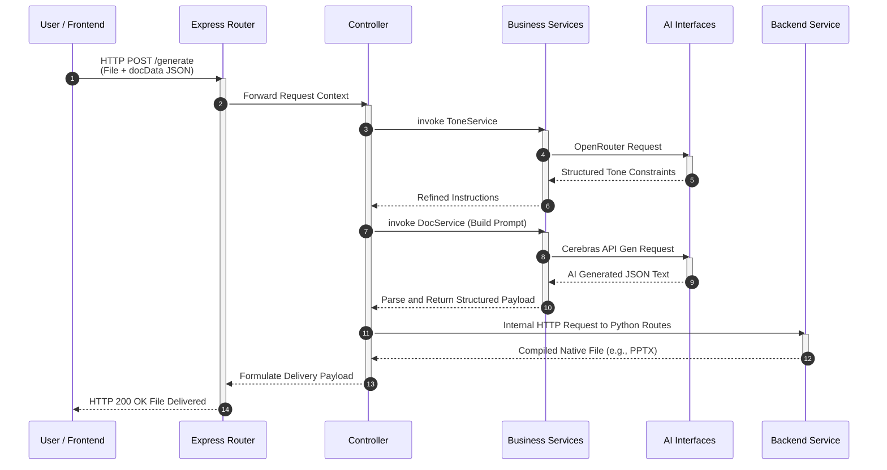

# docForU: Generation Data Flow

This document outlines the step-by-step process of how user requests are internally routed inside the newly structured MVC backend before finally resolving as a generated presentation or document.

## Flow Visualization

## Step-by-Step Breakdown

1. **User Request Initiation**: The frontend submits a compiled JSON of all user preferences (`docData`) and optionally attached files via a `POST /generate` request.
2. **Routing the Request**: The `routes` layer (e.g., `generateRoute.js`) securely captures the HTTP traffic and passes the parameters onward.
3. **Controller Orchestration**: The `generateController.js` governs the overall workflow. It evaluates the uploaded parameters.
5. **Content Generation Service**: The main body of work moves to `docService.js`. Here, templated prompts are constructed. It invokes `ai/cerebras.js` to securely generate the content, returning structured JSON blocks.
6. **Microservice Delegation**: The core data is finalized as structured JSON. The controller then forwards the rendering responsibilities to the FastAPI-powered **Backend** service over its internal route endpoints.
7. **Document Compilation**: A specific service script (e.g., `services/ppt_service.py` inside the Python environment) translates the JSON hierarchy into actual slides and titles.
8. **Delivery**: The binary data flows back from Backend, to the Express controller, through the router, and ultimately back to the user's browser for download.
