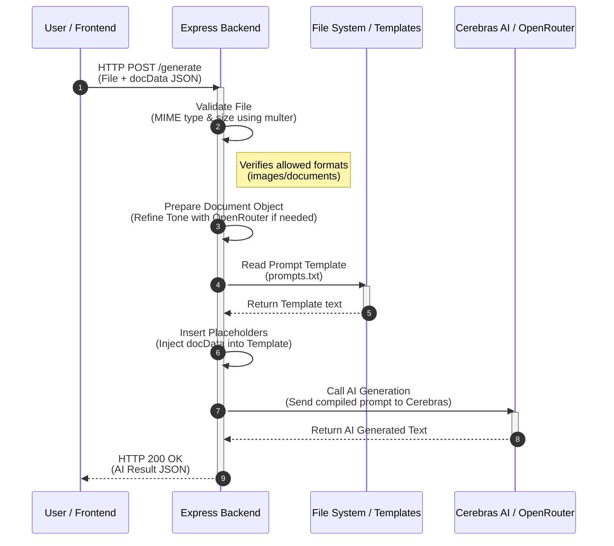

# docForU: Generation Data Flow

This document outlines the step-by-step process of how user requests are handled by the system, from the initial upload to the final AI-generated response.

## Flow Visualization

## Step-by-Step Breakdown

1. **User Request Initiation**: The user uploads a file and submits the structured configuration (`docData`) via the frontend wizard.
2. **Payload Validation**: The backend utilizes `multer` to validate the uploaded file, enforcing size limits and verifying allowed MIME types/extensions.
3. **Data Preparation**: The system prepares the `docData` object. If the user provided tone rules, the backend may call **OpenRouter** to refine these instructions into precise LLM constraints.
4. **Template Retrieval**: The specific prompt template (`prompts.txt`) is read from the local file system.
5. **Prompt Compilation**: The system maps the properties of `docData` into the template placeholders to formulate a comprehensive set of instructions.
6. **AI Content Generation**: The finalized prompt string is dispatched to the **Cerebras AI** API for rapid, high-quality content generation.
7. **Response Delivery**: The generated markdown or structured text is wrapped in a JSON response and returned to the frontend.