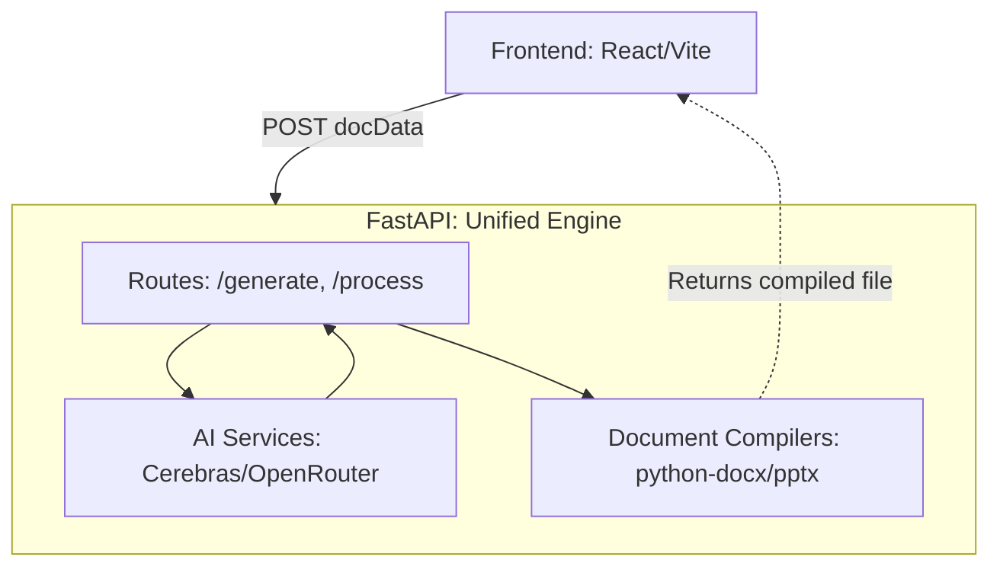

# 🚀 docForU

**docForU** is an AI-powered document generation platform that helps users create **structured presentations and documents** with precise control over content organization.

Unlike traditional AI tools that generate generic text, docForU focuses on **controlled, structured generation**, where content is created in a predefined format and directly converted into downloadable native files like PPTs and DOCs.

---

## 🎯 Current Focus (v2 - Unified Engine)

docForU has been updated to use a **unified FastAPI backend** for all logic, eliminating the redundant Node.js proxy.

- ✅ AI-generated **structured JSON output**
- ✅ Automatic **PowerPoint (PPTX) and Word (DOCX) generation**
- ✅ Unified Flow: User Input → FastAPI (AI + Processing) → File Compilation → Download
- ✅ Direct File Upload & Analysis (DOCX/PPTX)

---

## 🏗️ Architecture (v2)



---

## 🧩 Tech Stack

### Frontend
- **React + Vite**
- TailwindCSS

### Unified Backend (Backend)
- **FastAPI (Python)**
- AI Orchestration (Cerebras & OpenRouter)
- Python rendering libraries (`python-pptx`, `python-docx`)

---

## 📁 Project Structure

```text
docForU
│
├── Backend/              # Unified Python Backend (Current Engine)
│   ├── services/            # AI, Prompts, and File Compiling
│   ├── prompts/             # System templates for AI
│   ├── main.py              # Application entry point
│   └── requirements.txt     # Python dependencies
│
├── Frontend/                # React Web Client
│   ├── src/
│   │   ├── api/             # API communication layer
│   │   ├── genDoc/          # Generation UI components
│   │   └── tempInj/         # Template upload logic
│   └── ...
│
├── Backend/                 # Legacy Node.js Orchestration (Deprecated)
│
└── README.md
```

---

## ⚙️ Installation

### 1. Clone the repository
```bash
git clone https://github.com/msv6264/docForU.git
cd docForU
```

### 2. Backend Setup (FastAPI)
```bash
cd Backend
python -m venv venv
venv\Scripts\activate   # On Windows
pip install -r requirements.txt
uvicorn main:app --reload
```

### 3. Frontend Setup
```bash
cd Frontend
npm install
npm run dev
```

---

## 🔐 Environment Variables

Create a `.env` file in **Backend**:

```env
CEREBRAS_API_KEY=your_api_key_here
OPEN_ROUTER_API_KEY=your_api_key_here
```

Update `Frontend/.env` to point to the FastAPI server:
```env
VITE_API_URL=http://localhost:8000
```

---

## 👩‍💻 Author
**Sri Vaishnavi**
- GitHub: https://github.com/msv6264
- LinkedIn: https://www.linkedin.com/in/sri-vaishnavi-95023630a/
