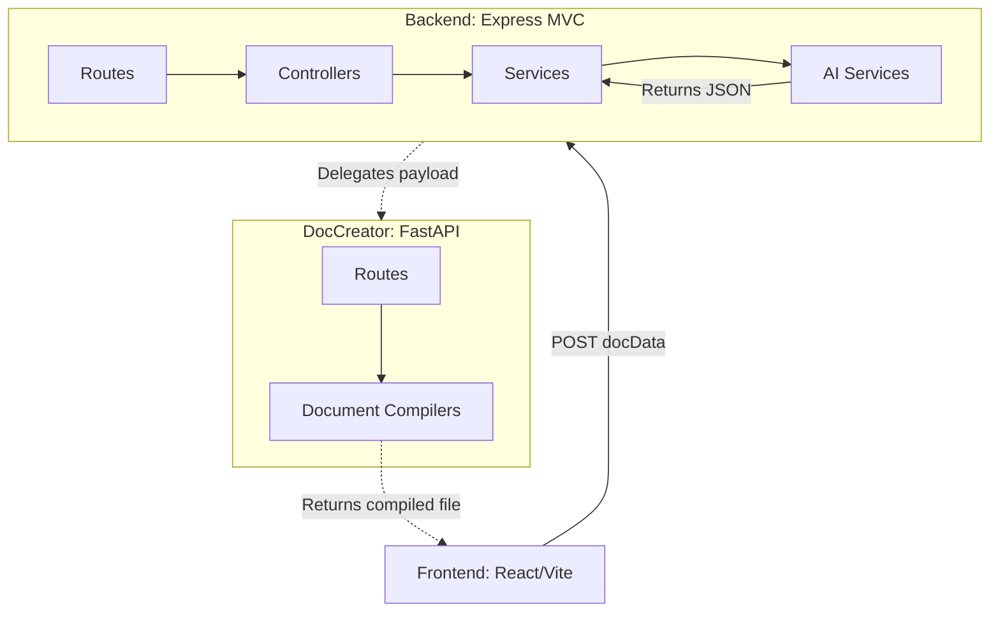

# 🚀 docForU

**docForU** is an AI-powered document generation platform that helps users create **structured presentations and documents** with precise control over content organization.

Unlike traditional AI tools that generate generic text, docForU focuses on **controlled, structured generation**, where content is created in a predefined format and directly converted into downloadable native files like PPTs.

---

## 🎯 Current Focus (v1)

docForU currently supports:

- ✅ AI-generated **structured JSON output**
- ✅ Automatic **PowerPoint (PPTX) generation**
- ✅ End-to-end flow: User Input → AI Orchestration → File Compilation → Download

🚧 In Progress:

- DOCX generation
- PDF generation
- Template-based generation

---

## 💡 Why docForU?

Most document generators:
❌ Generate unstructured or loosely formatted content.
❌ Offer limited control over section distribution.

docForU solves this by:

- Allowing users to define **structure, headings, and size**.
- Generating content in a **strict JSON format**.
- Abstracting complex data structures into an elegant multi-service MVC architecture.
- Converting that structure into **submission-ready, native documents**.

---

## ✨ Features

- 🧠 AI-powered structured content generation
- 📊 Automatic PPTX compilation from AI-generated constraints
- 🎯 Section-wise content control
- ⚡ Asynchronous, end-to-end generation pipelines
- 🔄 Multi-service Architecture (React + Express MVC + FastAPI DocCreator)
- 🧩 Modular prompt and tone refinement system

---

## 🧩 Tech Stack

### Frontend

- **React + Vite**
- TailwindCSS

### Backend

- **Node.js + Express.js**
- Structured using **MVC and Service** patterns.

### AI Integration

- **Cerebras API** (Rapid content generation)
- **OpenRouter API** (Instruction and tone refinement)

### Document Service (DocCreator)

- **Python + FastAPI**
- Python rendering libraries (`python-pptx`)

---

## 🏗️ Architecture



---

## 📁 Project Structure

```text
docForU
│
├── Backend/                 # Express AI Orchestration
│   ├── ai/           # External LLM integrations (Cerebras, OpenRouter)
│   ├── controllers/         # Request handling and workflow management
│   ├── prompts/             # System templates
│   ├── routes/              # Express API endpoints
│   ├── services/            # Business logic (docService, toneService)
│   └── server.js            # Express application entry point
│
├── Frontend/                # React Web Client
│   ├── src/
│   │   ├── components/
│   │   ├── genDoc/
│   │   ├── App.jsx
│   │   └── main.jsx
│   └── ...
│
├── DocCreator/              # Python Rendering Microservice
│   ├── routes/              # FastAPI endpoints
│   ├── services/            # File compiling scripts (ppt_service.py)
│   ├── models/              # Data structures
│   └── main.py              # Application entry point
│
├── DOCUMENTATIONS/          # Extensive architectural docs
│
└── README.md
```

---

## ⚙️ Installation

### 1. Clone the repository

```bash
git clone https://github.com/msv6264/docForU.git
cd docForU
```

### 2. Backend Setup

```bash
cd Backend
npm install
node server.js
```

### 3. Frontend Setup

```bash
cd Frontend
npm install
npm run dev
```

### 4. DocCreator Setup (FastAPI)

```bash
cd DocCreator
python -m venv venv
venv\Scripts\activate   # On Windows
pip install -r requirements.txt
uvicorn main:app --reload
```

---

## 🔐 Environment Variables

Create a `.env` file in **Backend**:

```env
CEREBRAS_API_KEY=your_api_key_here
OPENROUTER_API_KEY=your_api_key_here
PORT=5000
```

⚠️ Never commit `.env` files.

---

## 🚀 Future Improvements

- 📄 DOCX generation
- 📑 PDF generation
- 📁 Template upload & injection ⭐
- 📂 “My Documents” dashboard
- ⚡ Performance improvements
- 🎯 Simplified user flow

---

## 👩‍💻 Author

**Sri Vaishnavi**

- GitHub: https://github.com/msv6264
- LinkedIn: https://www.linkedin.com/in/sri-vaishnavi-95023630a/

---

## ⭐ Support

If you found this project useful, consider giving it a ⭐ on GitHub!
